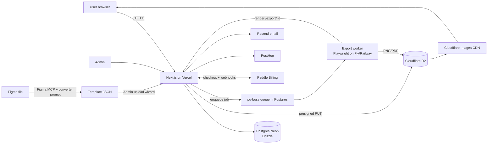

# 01 — MASTER SHEET: Casefolio

> **مقدمة:** هذه الوثيقة المرجعية الرئيسية لمشروع Casefolio: الرؤية، النطاق، المعمارية، نموذج البيانات، خريطة المسارات، هيكل المجلدات، ومتغيرات البيئة. اقرأها قبل أي مهمة.

## 1. Vision
Casefolio helps designers build polished UI case studies in minutes: pick a project type (Mobile / Web / Both), choose a professionally designed template, fill in images, text and colors in a **constrained** editor, then publish, share and export (PNG long, PDF, Behance-sized).

## 2. Scope
**Users:** landing page, auth, onboarding, dashboard, create-project wizard, editor (content / style / sections, image slots, palette, fonts), publish/share/export, view analytics, subscriptions (Free / Pro / Team, Pro badges & gating), account/billing, notifications, help. Responsive desktop + mobile.
**Admins:** overview, templates list/filters, upload wizard (imports JSON produced by the Figma→Puck converter), template detail + versions, categories, users, subscriptions, moderation, analytics, settings/roles.
**Out of scope (v1):** free canvas drawing, real-time multiplayer, custom domains, AI writing (v2).

## 3. Design source
- Figma file key **`4otk3FXD0q1TJ7aPGEIeGO`** — read with **Figma MCP** (`get_metadata`, `get_design_context`, `get_variable_defs`, `get_screenshot`).
- Pages: **All in One** (design system), **Landing Page** node `27:6665`, **Admin Panel** node `31:6665`.
- Brand: primary indigo **#4F46E5**, fonts **Geist** (UI) + **JetBrains Mono** (code/numbers). All values come from Figma variables → `src/styles/tokens.css`.
- Templates: designed in Figma using `template/<slug>`, `section/<type>`, `slot/<name> [ratio=W:H]`, `text/<name>`, `list/<name>`; converted with `reference/figma-to-puck-prompt.md` into JSON shaped like `reference/template.example.json`.

## 4. Stack (locked)
| Layer | Choice |
|---|---|
| Framework | Next.js (App Router) + TypeScript strict + pnpm |
| UI | Tailwind CSS v4 + shadcn/ui, tokens from Figma |
| Editor | Puck `@puckeditor/core` 0.24 (constrained, fields-only) |
| Rich text | TipTap (custom Puck field) |
| State/undo | Zustand + Immer + zundo |
| API | Server Actions + Route Handlers (zod-validated) |
| DB/ORM | Postgres (Neon; Supabase acceptable) + Drizzle |
| Storage/CDN | Cloudflare R2 + Cloudflare Images |
| Crop | react-easy-crop |
| Auth | Better Auth (+ organization plugin) |
| Payments | Paddle Billing (Merchant of Record) |
| Export | Playwright worker on Fly.io/Railway, queue via pg-boss; Satori for OG |
| Email | Resend + React Email |
| Analytics | PostHog + own `page_views` table |
| Hosting | Vercel (web) + Fly/Railway (worker) |
| Monitoring | Sentry |

## 5. Architecture


## 6. Data model (ERD)
```mermaid
erDiagram
  users ||--o{ projects : owns
  users ||--o{ memberships : has
  organizations ||--o{ memberships : has
  organizations ||--o{ projects : owns
  users ||--o| subscriptions : has
  organizations ||--o| subscriptions : has
  categories ||--o{ templates : groups
  templates ||--o{ template_versions : has
  template_versions ||--o{ projects : pinned_by
  projects ||--o{ assets : uses
  projects ||--o{ exports : produces
  projects ||--o{ page_views : receives
  projects ||--o{ reports : flagged_by
  users ||--o{ notifications : receives
  users ||--o{ audit_logs : performs

  users { uuid id PK; text email; text name; text role "user|admin|superadmin"; text plan; bool suspended; timestamptz created_at }
  organizations { uuid id PK; text name; text slug; int seats }
  memberships { uuid user_id FK; uuid org_id FK; text role "owner|editor|viewer" }
  categories { uuid id PK; text name; text slug; int sort }
  templates { uuid id PK; text slug; text name; text type "mobile|web|both"; uuid category_id FK; text tier "free|pro"; text status "draft|published|archived"; text cover_url; uuid current_version_id }
  template_versions { uuid id PK; uuid template_id FK; text version; jsonb data "template+puck"; text changelog; timestamptz published_at }
  projects { uuid id PK; uuid owner_id FK; uuid org_id FK; uuid template_version_id FK; text name; text type; jsonb puck_data; jsonb theme; text slug; text visibility "private|unlisted|public"; timestamptz published_at; timestamptz updated_at }
  assets { uuid id PK; uuid project_id FK; text r2_key; text slot; jsonb crop; int width; int height; int bytes }
  exports { uuid id PK; uuid project_id FK; text format "png_long|pdf|behance"; text status; text r2_key; timestamptz created_at }
  subscriptions { uuid id PK; uuid user_id FK; uuid org_id FK; text paddle_subscription_id; text plan "free|pro|team"; text status; timestamptz current_period_end }
  page_views { bigint id PK; uuid project_id FK; text visitor_hash; text referrer; text country; timestamptz at }
  notifications { uuid id PK; uuid user_id FK; text kind; jsonb payload; timestamptz read_at }
  reports { uuid id PK; uuid project_id FK; text reason; text status }
  audit_logs { uuid id PK; uuid actor_id FK; text action; jsonb meta; timestamptz at }
```

## 7. Routes map
| Group | Route | Purpose |
|---|---|---|
| marketing | `/`, `/pricing`, `/templates`, `/help`, `/help/[slug]`, `/legal/*` | Public |
| auth | `/sign-in`, `/sign-up`, `/verify`, `/reset` | Better Auth |
| app | `/onboarding` | First run |
| app | `/dashboard` | Projects grid |
| app | `/new` → `/new/type` → `/new/template` → `/new/details` | Create wizard |
| app | `/editor/[projectId]` | Constrained Puck editor |
| app | `/projects/[id]/share`, `/projects/[id]/exports`, `/projects/[id]/analytics` | Publish & stats |
| app | `/account`, `/account/billing`, `/account/team`, `/notifications` | Settings |
| public | `/p/[slug]` | Published case study |
| internal | `/export/[jobId]?token=` | Render target for Playwright |
| admin | `/admin`, `/admin/templates`, `/admin/templates/new`, `/admin/templates/[id]`, `/admin/categories`, `/admin/users`, `/admin/subscriptions`, `/admin/moderation`, `/admin/analytics`, `/admin/settings` | Admin |
| api | `/api/auth/*`, `/api/uploads/presign`, `/api/paddle/webhook`, `/api/exports`, `/api/track` | Handlers |

## 8. Folder structure
```
casefolio/
├─ apps/
│  ├─ web/                      # Next.js
│  │  └─ src/
│  │     ├─ app/(marketing)/ (auth)/ (app)/ (admin)/ p/[slug]/ export/[jobId]/ api/
│  │     ├─ components/ui/      # shadcn (token-styled)
│  │     ├─ components/editor/  # Puck config, fields (ImageSlotField, RichTextField, ThemePanel)
│  │     ├─ components/sections/# Hero, Overview, Problem, Process, ScreensGallery, Results, Quote, CTA, Custom
│  │     ├─ lib/{auth,db,billing,entitlements,storage,analytics,template}/
│  │     ├─ stores/             # zustand + zundo
│  │     ├─ styles/tokens.css   # generated from Figma
│  │     └─ env.ts
│  └─ worker/                   # Playwright export worker (Dockerfile)
├─ packages/
│  ├─ db/                       # drizzle schema, migrations, seed
│  └─ template-schema/          # zod schema shared by web + worker
├─ reference/                   # figma-to-puck prompt + template.example.json
└─ tests/e2e/
```

## 9. Environment variables
```
DATABASE_URL=
BETTER_AUTH_SECRET=
BETTER_AUTH_URL=
GOOGLE_CLIENT_ID=
GOOGLE_CLIENT_SECRET=
RESEND_API_KEY=
R2_ACCOUNT_ID=
R2_ACCESS_KEY_ID=
R2_SECRET_ACCESS_KEY=
R2_BUCKET=
CF_IMAGES_ACCOUNT_HASH=
CF_IMAGES_API_TOKEN=
NEXT_PUBLIC_PADDLE_CLIENT_TOKEN=
PADDLE_API_KEY=
PADDLE_WEBHOOK_SECRET=
PADDLE_ENV=sandbox
PADDLE_PRICE_PRO_MONTHLY=
PADDLE_PRICE_PRO_YEARLY=
PADDLE_PRICE_TEAM_MONTHLY=
PADDLE_PRICE_TEAM_YEARLY=
EXPORT_WORKER_URL=
EXPORT_SIGNING_SECRET=
NEXT_PUBLIC_POSTHOG_KEY=
NEXT_PUBLIC_POSTHOG_HOST=
SENTRY_DSN=
NEXT_PUBLIC_APP_URL=
```

## 10. Plans (initial)
| Feature | Free | Pro | Team |
|---|---|---|---|
| Projects | 2 | Unlimited | Unlimited |
| Templates | Free only | All (Pro badge) | All |
| Export | PNG, watermark | PNG/PDF/Behance, no watermark | + brand kit |
| Analytics | Views count | Full | Full |
| Seats | 1 | 1 | 3+ |
